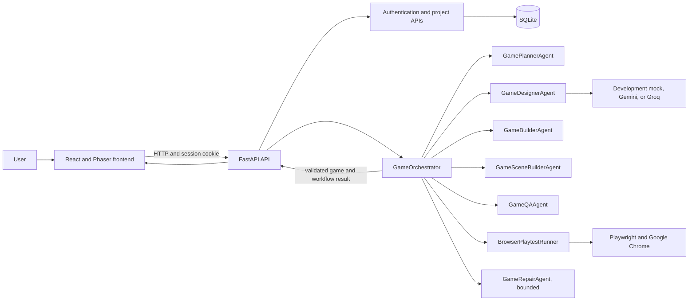

# GameionX

**AI-Powered Prompt-to-Playable Game Generation Platform Using Agentic AI**

GameionX is a web application that turns a natural-language game prompt into a
validated game specification and a playable browser preview. It combines a
React and Phaser frontend with a FastAPI backend, a provider-backed game design
step, deterministic Python workflow components, structural validation, and
bounded browser playtesting.

The project is a capstone prototype. Its development mock is deterministic and
does not use an AI model. Gemini and Groq adapters are implemented, but real
provider availability and successful live generation depend on external
credentials, model access, and service availability; this repository does not
claim that a live provider request has been verified.

## Problem statement

Creating a small playable game typically requires translating an idea into
mechanics, a structured game design, runtime configuration, and working
frontend behavior. These steps can be time-consuming for beginners and
difficult to validate consistently.

GameionX explores how a prompt-driven workflow can make this process more
accessible while keeping generated content constrained to validated data
rather than executing model-generated source code.

## Objectives

- Accept a natural-language game prompt through a web interface.
- Convert the prompt into a typed, validated `GameSpec`.
- Translate the specification into configuration for a controlled Phaser
  runtime.
- Check structural consistency and, when the browser test environment is
  available, observe selected gameplay behaviors.
- Preserve generated projects in SQLite and scope project operations to the
  authenticated owner.
- Report incomplete or failed validation honestly instead of treating it as a
  successful game.

## Proposed solution

The backend plans prompt requirements, obtains a game design from the selected
provider, validates the design, constructs runtime and scene configuration,
and runs QA. Browser checks use Playwright with installed Google Chrome and
the existing frontend preview. A small, allowlisted repair may be attempted
once for supported diagnosed problems; output is validated and tested again.
The frontend renders the resulting data in a controlled Phaser preview.

The workflow is implemented in Python and is orchestrated by
`GameOrchestrator`. It does **not** use LangGraph: there is no LangGraph
dependency or LangGraph runtime in the project.

## Key features

### Implemented

- React-based application with prompt entry, game library, template gallery,
  agent information, settings, and a Phaser game preview.
- Backend `GameSpec` validation using Pydantic.
- Development-mock, Gemini, and Groq provider adapters. The development mock
  is not an LLM; provider selection does not silently convert a failed real
  provider request into mock output.
- Structured generation requests, bounded provider retries, configured
  fallback handling, and an end-to-end provider deadline.
- Controlled Phaser runtime configuration for supported genres and mechanics.
- Structural QA and bounded Playwright/Chrome playtests. QA distinguishes
  failures from checks that could not be completed.
- Authentication, session cookies, SQLite persistence, and
  owner-scoped saved-game/project operations.
- Unit and integration-oriented backend and frontend test suites.

### Partial, demo-only, or not implemented

- The Templates gallery uses local static template data; it is not backed by a
  template service.
- The Agents page presents informational cards. The backend workflow
  components are implemented, but those cards are not a live orchestration
  monitor.
- The Game Time Machine displays placeholder timeline entries; restore and
  version comparison are not implemented.
- Community cards use demo data and their preview controls are disabled.
  There is no community publishing or sharing API.
- Analytics includes counts derived from the signed-in user's saved games, but
  the performance chart is demo-style derived data, not backend generation
  telemetry.
- Reference-file upload controls are marked as coming soon and are disabled.
- Provider adapters and offline tests do not establish that a live Gemini or
  Groq request will succeed for a particular account or model.

## System architecture



The backend exposes FastAPI's interactive OpenAPI documentation. SQLite is
initialized by the backend on startup. The frontend calls the backend API and
renders the validated runtime data; it does not execute generated game code.

## Agent and workflow responsibilities

| Component | Responsibility |
|---|---|
| `GamePlannerAgent` | Deterministically extracts supported genre, entity, mechanic, and UI requirements from the prompt. |
| `GameDesignerAgent` | Requests structured design output from the configured provider, validates it as a `GameSpec`, and performs a bounded retry for invalid output. |
| `GameBuilderAgent` | Validates and translates `GameSpec` into controlled Phaser runtime configuration. |
| `GameSceneBuilderAgent` | Produces declarative UI and instruction configuration from runtime capabilities. |
| `GameQAAgent` | Runs deterministic structural checks and combines them with browser-playtest results. |
| `BrowserPlaytestRunner` | Uses Playwright and Google Chrome for bounded, observable checks against the existing frontend preview. |
| `GameRepairAgent` | Applies only supported deterministic repairs, limited by the orchestrator to at most one attempt, then the result is revalidated and retested. |
| `GameOrchestrator` | Runs the workflow in order, records stage and requirement outcomes, and determines whether the result is ready, unverified, or failed. |

This is a coordinated Python workflow, not an autonomous LangGraph graph.
Structural validity alone does not mean browser gameplay was verified.

## Technology stack

| Area | Technologies |
|---|---|
| Frontend | React, Vite, JavaScript, CSS |
| Browser game runtime | Phaser 3 |
| Backend API | Python, FastAPI, Uvicorn |
| Data validation | Pydantic |
| Persistence | SQLite |
| Provider integrations | Google GenAI SDK for Gemini; HTTPX for the Groq-compatible API |
| Browser testing | Playwright with Google Chrome |
| Tests and lint | pytest, Node.js test runner, Oxlint |

## Repository structure

```text
gameionx/
├── backend/
│   ├── app/
│   │   ├── agents/              # Planner, designer, builder, QA, repair, orchestration
│   │   ├── auth.py              # Password hashing and session handling
│   │   ├── database.py          # SQLite initialization and connection helpers
│   │   ├── main.py              # FastAPI app and API routes
│   │   ├── models.py            # Request, response, GameSpec, and workflow schemas
│   │   ├── playtest.py          # Playwright/Chrome gameplay checks
│   │   └── provider.py          # Development mock, Gemini, and Groq providers
│   ├── tests/                   # Backend API, agent, model, and playtest tests
│   ├── .env.example             # Safe environment configuration template
│   ├── pytest.ini
│   └── requirements.txt
├── frontend/
│   ├── src/
│   │   ├── components/          # Phaser preview and rendering helpers
│   │   ├── gameRuntime/         # Runtime adapter and game mechanics
│   │   ├── lib/                 # API and platform data helpers
│   │   ├── App.jsx
│   │   └── ...
│   ├── tests/                   # Node.js frontend tests
│   ├── .env.example
│   └── package.json
├── .gitignore
└── README.md
```

## Requirements

- Python 3.11 or newer and `pip`
- Node.js and npm
- Google Chrome installed for browser playtests (the runner launches Chrome's
  `chrome` channel)
- Gemini or Groq credentials only if using those real providers

The development mock can be used without provider credentials. It is intended
for development and testing, not as evidence of live AI generation.

## Installation and local development

### 1. Set up the backend

In PowerShell:

```powershell
Set-Location C:\Projects\gameionx\backend
py -3 -m venv .venv
.\.venv\Scripts\Activate.ps1
python -m pip install --upgrade pip
python -m pip install -r requirements.txt
if (-not (Test-Path .env)) { Copy-Item .env.example .env }
```

On macOS or Linux, from the repository root:

```sh
cd backend
python3 -m venv .venv
. .venv/bin/activate
python -m pip install --upgrade pip
python -m pip install -r requirements.txt
test -f .env || cp .env.example .env
```

The example configuration selects `development-mock` by default. Keep provider
credentials in the ignored `backend/.env`; never place them in frontend
configuration or commit them. To use a real provider, select `gemini` or
`groq` with `GAMEIONX_PROVIDER` and configure the corresponding backend
credential and any desired model settings. Model access and provider
availability are account- and service-dependent.

Start the backend from `backend/` with the virtual environment active:

```sh
python -m uvicorn app.main:app --reload --port 8000
```

The backend initializes the SQLite database on startup. By default it is
`backend/gameionx.sqlite3`; `GAMEIONX_DATABASE_PATH` can select another path.
The database and environment files are excluded from Git.

### 2. Set up the frontend

Open a second terminal:

```sh
cd frontend
npm install
npm run dev
```

Vite prints the local frontend URL, normally `http://localhost:5173`. The
frontend resolves the local API host automatically for `localhost` and
`127.0.0.1`. To point it to another backend origin, set
`VITE_API_BASE_URL` before starting Vite, or configure it in an ignored
frontend environment file.

### 3. Open API documentation

With the backend running, visit:

- Swagger UI: `http://localhost:8000/docs`
- OpenAPI JSON: `http://localhost:8000/openapi.json`
- Health endpoint: `http://localhost:8000/api/health`

The API includes generation (`POST /api/generate`), authentication
(`/api/auth/*`), saved games (`/api/games`), owner-scoped projects
(`/api/projects`), and activity (`GET /api/activity`). Protected routes
require the session cookie established by registration or login.

## Testing and quality checks

Run backend tests from `backend/` with the environment active:

```sh
python -m pytest -v
```

Run frontend checks from `frontend/`:

```sh
npm test
npm run lint
npm run build
```

Backend browser playtests require installed Google Chrome. The runner uses
`GAMEIONX_FRONTEND_URL` to target a frontend server (default
`http://127.0.0.1:5173`) and starts the local Vite frontend when that server
is not already available. `PLAYTEST_BUDGET_SECONDS` sets the test time budget.
If the browser environment is unavailable or a required check cannot complete,
the report may mark gameplay **NOT TESTED**; that must not be interpreted as a
pass.

## Current implementation status

| Area | Status |
|---|---|
| Prompt intake, supported `GameSpec` schemas, and runtime adaptation | Implemented |
| Development-mock generation | Implemented for supported mock mechanics; not model-generated |
| Gemini/Groq provider adapters, retry handling, and deadline logic | Implemented; live provider success is not guaranteed or claimed |
| Game planning, design, build, scene configuration, QA, orchestration, and bounded repair | Implemented in Python; not LangGraph |
| Phaser preview and selected gameplay mechanics | Implemented for registered/supported mechanics |
| Browser gameplay verification | Implemented for selected checks; each individual run can remain unverified |
| Registration, login, sessions, SQLite persistence, owner-scoped games/projects | Implemented |
| Templates and agent information pages | Static frontend content |
| Community sharing and live community gallery | Demo-only; sharing API not implemented |
| Analytics | Some counts use the signed-in user's saved projects; performance chart is demo-style, not backend telemetry |
| Game Time Machine version comparison and restore | Placeholder UI; not implemented |
| Reference upload | Disabled/coming soon |
| LangGraph orchestration | Not implemented |

“Implemented” describes code paths in this repository; it is not a claim of
production readiness or live external-service availability.

## Future enhancements

These are possible next steps, not current capabilities:

- Persist version history and implement safe comparison and restoration.
- Add backend-backed community publishing, sharing, and moderation.
- Add generation telemetry and analytics endpoints.
- Implement reference-file upload with validation and storage controls.
- Expand browser gameplay coverage for more scenarios and runtime mechanics.
- Add deployment-specific operational guidance, monitoring, and security review.
- Select and add an explicit project license.

## Contributing

External contributions are welcome. Before proposing a change:

1. Check existing issues and project behavior to avoid duplicating work.
2. Keep changes focused and preserve the validated API and GameSpec contracts.
3. Add or update tests for behavior changes; do not weaken existing assertions
   to make a run pass.
4. Run the relevant backend or frontend checks listed above and report any
   checks that could not run.
5. Do not include credentials, local `.env` files, SQLite databases, or
   generated dependency/build/cache directories.
6. Submit a pull request describing the change, validation performed, and any
   limitations or follow-up work.

## License

No `LICENSE` file or license declaration is currently present in this
repository. No license is asserted here. Ask the project owner to choose a
license before redistributing or reusing the project; do not assume that the
source is open-licensed.
